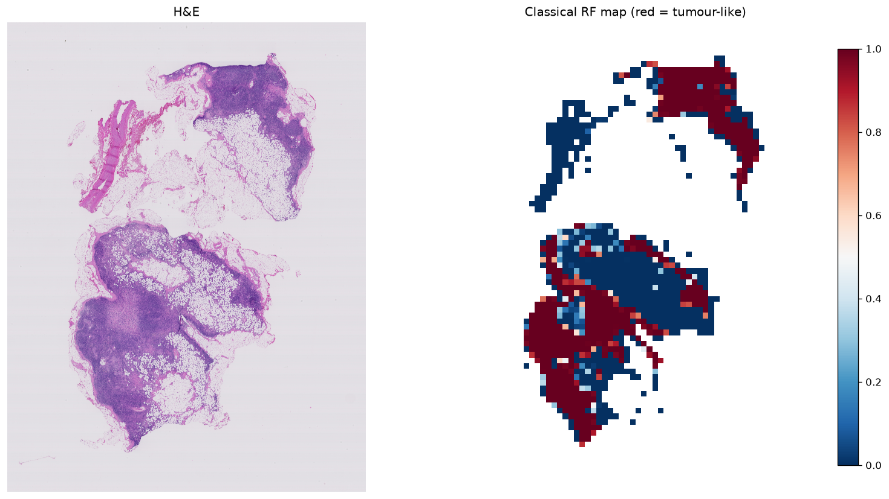

# wsi-classical-qupath classical WSI cancer analysis


A fully-scriptable, reproduction of the pre-deep-learning histopathology
recipe — the approach behind [**QuPath**](https://qupath.github.io) (Bankhead et al.,
*Sci. Rep.* 2017) and surveyed in Gurcan et al., *IEEE RBME* 2009. Everything runs in a
VS Code / Jupyter notebook with `openslide` + `scikit-image` + `scikit-learn`.



Run on `tumor_084` from CAMELYON16 — the same slide used for the deep dive in
[lazyslide-wsi-pipeline](https://github.com/koul00/lazyslide-wsi-pipeline#single-slide-deep-dive-tumor_084),
so the classical map above can be compared directly against that repo's
zero-shot tumour heatmap.

## The pipeline (`classical_pipeline.ipynb`)

Run top-to-bottom. Each stage is a classic building block of the era:

| Step | Method | Library |
|------|--------|---------|
| 1. Tissue detection | Otsu threshold on saturation | scikit-image |
| 2. Colour deconvolution | H&E → hematoxylin / eosin (Ruifrok & Johnston 2001) | `skimage.color.rgb2hed` |
| 3. Nuclei segmentation | distance-transform **watershed** | scikit-image |
| 4. Hand-crafted features | **Haralick / GLCM** texture + nuclei density + colour | `graycomatrix` |
| 5. Classification | **Random Forest** → whole-slide tumour-cellularity map | scikit-learn |

## Quick start

```bash
pip install -r requirements.txt
# download tumor_084 via lazyslide-wsi-pipeline's scripts/download_data.sh
# (or any CAMELYON16/own slide — just point `SLIDE` at it), then:
jupyter notebook classical_pipeline.ipynb     # or open it in VS Code and Run All
```

## Results (`tumor_084`, CAMELYON16)

- 1103 tissue tiles (256px grid on a 16× downsampled thumbnail) → 9 hand-crafted
  features each → weak-labeled Random Forest (728 training tiles, cellularity terciles).
- Top features by importance: `mean_R` (0.35), `nuclei_density` (0.27), `ASM` (0.16) —
  colour and nuclear density dominate over the texture descriptors.
- The map looks similar by eye to
  [lazyslide-wsi-pipeline](https://github.com/koul00/lazyslide-wsi-pipeline)'s
  zero-shot PLIP heatmap on the same slide (both mark a dense region in the
  lower-left lobe), but **that visual impression is not supported quantitatively** —
  see the next section.

### Quantitative check against the expert annotation

`evaluate_vs_xml.py` scores the same Random Forest map against CAMELYON16's
`tumor_084.xml` (the RF is trained on weak labels only, never on the XML, so there
is no leakage). Output: [`results/evaluation_vs_xml.txt`](results/evaluation_vs_xml.txt).

| Tile counts as tumour if… | tumour tiles | RF ROC-AUC (95% CI) |
|---|:---:|:---:|
| its centroid is inside the annotation | 29 / 1103 | **0.521** (0.46–0.58) |
| ≥ 25% of the tile overlaps it | 42 / 1103 | 0.578 (0.52–0.64) |
| ≥ 5% of the tile overlaps it | 64 / 1103 | 0.618 (0.56–0.67) |

For comparison, zero-shot PLIP reaches **0.946** on this slide. Only 1 of the 29
tumour tiles is among the RF's top-10% highest-scoring tiles. The map therefore
tracks **cellularity, not tumour**: in a lymph node, normal lymphoid tissue is also
densely cellular, which is exactly the weakness of the terciles rule used for the
weak labels.

One exploratory lead (not corrected for multiple comparisons, one slide): the GLCM
`correlation` feature alone separates tumour from non-tumour tiles with AUC 0.796
(lower correlation = tumour). Worth re-testing on the 27-slide cohort.

- **Every feature is hand-engineered** — no learned representations. This is the ceiling
  of classical digital pathology: stain unmixing, morphometry, and texture descriptors.
- **The classifier is a Random Forest** — the workhorse of the era.
- The output map is the hand-crafted-feature analogue of a deep attention map, which is
  exactly what Stages 2 (SAMPLER) and 3 (LazySlide) replace with learned features.

## A note on QuPath
QuPath is a Java desktop application, not a Python library. Rather than script its GUI,
this repo reimplements the *same classical techniques* QuPath uses internally
(watershed nuclei, Haralick texture, Random Forest object classification) as transparent,
reproducible Python — so the whole stage runs in VS Code. QuPath remains the canonical
reference tool for this era.

## Limitations (honest)
- Labels are **weak** (cellularity terciles), not expert annotations — this demonstrates
  the *method*, not clinical-grade tumour detection.
- Works at a downsampled level for the whole-slide map; nuclei segmentation is shown at 40x
  on one high-cellularity tile.

## References
- Bankhead et al. **QuPath: Open source software for digital pathology image analysis.** *Sci. Rep.* 2017.
- Gurcan et al. **Histopathological Image Analysis: A Review.** *IEEE RBME* 2009.
- Ruifrok & Johnston. **Quantification of histochemical staining by colour deconvolution.** 2001.
- Haralick et al. **Textural Features for Image Classification.** *IEEE SMC* 1973.
